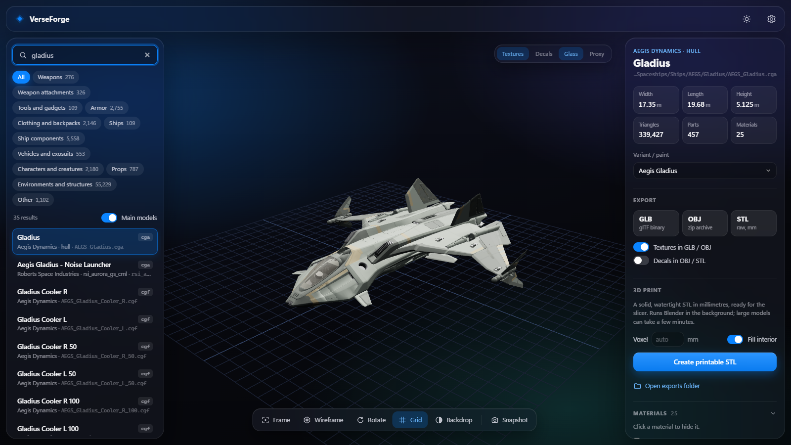
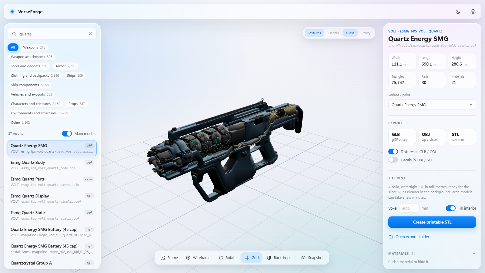
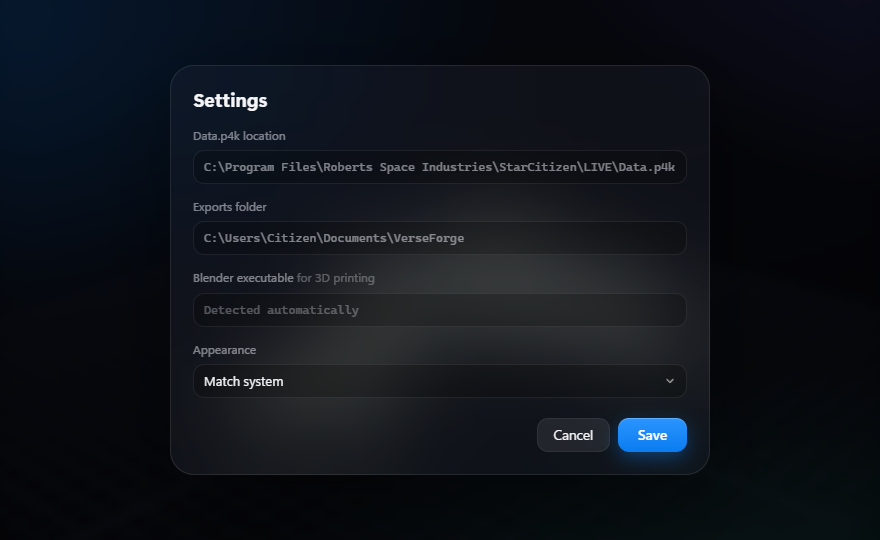

# VerseForge

A local Windows tool to **search, view in 3D and export** Star Citizen models (weapons, attachments, tools, armor,
clothing, ships, components, vehicles, props…) straight from the `Data.p4k` of your installed game.
It never modifies the game files and downloads nothing: the archive is opened read-only.



<details><summary>Light mode</summary>



</details>

<details><summary>Settings</summary>



</details>

> Unofficial fan project, not affiliated with or endorsed by Cloud Imperium Games. The repository **contains no game
> files, models or textures**: you need your own installed copy of Star Citizen.

The demo videos (`01_search_and_view.mp4`: search, viewer, ships, materials; `02_export_and_print.mp4`:
GLB/OBJ/STL export, STL for 3D printing, settings) are attached to the [Release](../../releases).
They are regenerated in `docs/video/` with `python tools/record_video.py` while the app is running: the script drives
Edge/Chrome in headless mode and compresses to H.264 with the Windows transcoder (`tools/compress_video.ps1`).

## Getting started

### Windows app (recommended)

Download **`VerseForge-<version>-Setup.exe`** from the [Releases](../../releases) page and install it: no administrator
rights and no Python needed. It adds a Start menu entry (and, if you want, a desktop icon); uninstall it from
*Settings → Apps*.

VerseForge opens in its own window, without a browser or a console, and also works offline.

### Browser version (from source)

Double-click **`Start VerseForge (browser).bat`**: it needs Python 3.11+ (the dependencies in `requirements.txt` are
installed automatically), the browser opens on <http://127.0.0.1:8765>, and closing the black console window stops it.
`python verseforge_app.py` runs the windowed version from source instead (it also needs PySide6:
`python -m pip install -r requirements-build.txt`, which installs PySide6 and PyInstaller).

### Where data is stored

| What | Where |
|---|---|
| Settings | `%APPDATA%\VerseForge\config.json` |
| Cache (Data.p4k index, names) | `%LOCALAPPDATA%\VerseForge` (rebuilt automatically after every patch) |
| Exports | `Documents\VerseForge` (can be changed in the settings) |
| Log of the .exe version | `%LOCALAPPDATA%\VerseForge\verseforge.log` |

By default the game is looked for in `C:\Program Files\Roberts Space Industries\StarCitizen\LIVE\Data.p4k`;
if it is somewhere else (or to use the PTU) change it in **Settings** (gear icon, top right). The "3D print" export needs Blender
(detected automatically, or set its path in the settings).

### Rebuilding the .exe

`build_exe.bat` rebuilds `dist\VerseForge\` (PyInstaller, `VerseForge.spec`) and the installer (Inno Setup,
`installer\VerseForge.iss`). The build dependencies (PySide6, PyInstaller) are in `requirements-build.txt`.
The version number lives in `sc_explorer/__init__.py`, `version_info.txt` and the .iss script.

## Usage

- **Search**: type in the box at the top left. In-game names ("P4-AR", "Morozov-SH", "Arrowhead"), ship names
  ("Gladius", "Cutlass") and file names ("brfl_fps_behr") all work. Dashes and spaces are ignored; with several
  words, all of them must match.
- **Categories**: the buttons filter by type. The "Main models" switch hides LODs, decals, physics proxies and ship
  interior parts: turn it off to see every single file.
- **Viewer**: drag to rotate, wheel to zoom, right button to pan.
  Keys: `F` frame, `W` wireframe, `R` auto-rotate, `G` grid (also in the toolbar at the bottom).
  Textures, decals, glass and proxies are toggled at the top right of the viewer; single materials can be hidden
  from the right panel.
- **Light / dark mode**: the sun/moon button in the top bar switches it; by default it follows Windows
  (also selectable in **Settings → Appearance**).
- **Variant / paint**: for weapons, armor, ships and items that have several skins or liveries in the game, a menu
  appears in the right panel (e.g. Quartz "Jungle Camo", Gladius liveries). Colours and materials come from the
  game database (`Game2.dcb`); the first entry is the default paint. Exports use the selected variant too.
- **Same folder**: list of the related parts (e.g. stock, magazines, wheels, interiors).
- Item names are the in-game (English) names.

## Export

| Format | Content |
|---|---|
| **GLB** | Binary glTF with materials and textures (colour + normal map, up to 2048 px), metres, Y up. Opens in Blender, Windows 3D Viewer, etc. |
| **OBJ** | Zip with `.obj` + `.mtl` + a `textures/` folder (JPG/PNG), metres, Y up |
| **STL** | Raw game surfaces in **millimetres**, Z up. Not closed: fine as a reference, not for printing |
| **STL for printing** | Closed, filled solid in mm, ready for the slicer (Blender in the background: solidify + voxel remesh, then the interior is filled). Large objects can take minutes |

Textures can be left out by turning off "Textures in GLB / OBJ" (much smaller files).
Every export is also saved in `Documents\VerseForge` (can be changed in the settings).
For a large print, splitting into pegged pieces has to be done separately (e.g. in Blender or in the slicer).

## Known limitations

- **Approximate textures**: the colour texture (`_diff`) and the normal map (`_ddna`) of every material are loaded;
  for layered materials (`LayerBlend`, `HardSurface` on ships and weapons) the first layer is used, repeated according
  to its `UVTiling`, with the palette colours of the selected variant. Wear, dirt, blend masks between layers,
  emissive lights and palette-coloured decals are not reconstructed: the result is close to the game but not
  identical. Use the **Textures** toggle at the top right of the viewer to compare.
- **Ships**: the hull is assembled with all its nodes (wings, landing gear, doors…). Weapons, engines and components
  mounted on hardpoints, and interiors (`.socpak` files), are separate objects that can be searched on their own.
- **In-game names**: derived from the order of the strings in DataCore (not a full parse). They are correct for
  almost all weapons, armor, clothing and vehicles; for decorative props they can be inaccurate, which is why the
  Environments/Other categories keep the file names.
- Some `.cdf`/`.cga` files are only containers without geometry: the program reports it.
- The models are the property of Cloud Imperium Games / Roberts Space Industries: use them only for personal,
  non-commercial purposes.

## Project structure

```
start.py                 browser version: server (uvicorn) and opening the browser
sc_explorer/p4k.py       Data.p4k reader (ZIP64, zstd, AES)
sc_explorer/ivo.py       #ivo geometry format (.cgf/.cga/.skin/.chr + *m files)
sc_explorer/cryxml.py    CryEngine binary XML (.mtl, .cdf)
sc_explorer/materials.py materials: names, colours, textures, kind (solid/decal/glass/proxy)
sc_explorer/datacore.py  game database reader (Game2.dcb, format v8)
sc_explorer/variants.py  paints: for every model, the skins/liveries with their material and colour palette
sc_explorer/textures.py  .dds textures split into mips (.dds.1 … .dds.N), BC1–BC7 decoding (signed BC5 by hand)
sc_explorer/model.py     assembly: ship nodes, .cdf attachments on bones
sc_explorer/catalog.py   catalogue, categories, in-game names, search
sc_explorer/i18n.py      texts produced by the server (status, categories, warnings)
sc_explorer/export.py    GLB / OBJ / STL
sc_explorer/printing.py  closed STL for 3D printing (Blender + interior fill)
sc_explorer/server.py    web API
web/                     interface (HTML/CSS/JS); three.js 0.160 bundled in web/vendor (MIT license)
verseforge_app.py        windowed app (Qt WebEngine), entry point of VerseForge.exe
VerseForge.spec          PyInstaller configuration; installer/VerseForge.iss for Inno Setup
tests/test_formats.py    tests against the installed game (python -m pytest tests; skipped if Data.p4k is missing)
tools/                   recording and compression of the demo videos
```

Format details discovered during development:

- Vertex stream `0xB3A70D5E`: snorm16 position scaled by `max(|max-min|/2, 1)` per axis and offset to the centre of
  the bounding box; `0x91329AE9`: float32 position. The mesh header has two bounding boxes: the first (offset +24)
  is in object space, the second (+48) is the union of the nodes' local boxes. If the file has a node table, the
  positions must be decoded with the second one and then transformed by the node (`ivo.mesh(..., node_space=True)`):
  with the first one, large multi-node ships (e.g. Perseus) came out shifted and distorted. LODs without nodes use the
  first one.
- Mesh subset (48 bytes): `material | node<<16`, first index, index count, first vertex, **index base**
  (to be added to the 16-bit indices), vertex count.
- Node chunk `0x70697FDA`: 208-byte records; the first 3×4 matrix is the transform into object space.
  Indices, material ids and the node name table follow.
- Bones `0xC2011111`: 68-byte records (id, parent, relative and world quaternion and position), names at the end.

## License

VerseForge's code is released under the [MIT](LICENSE) license. The license covers only the code: Star Citizen, its
files and the models/textures read from `Data.p4k` remain the property of Cloud Imperium Games / Roberts Space
Industries and should be used only for personal, non-commercial purposes. three.js (`web/vendor/three`) is bundled
under the MIT license.
