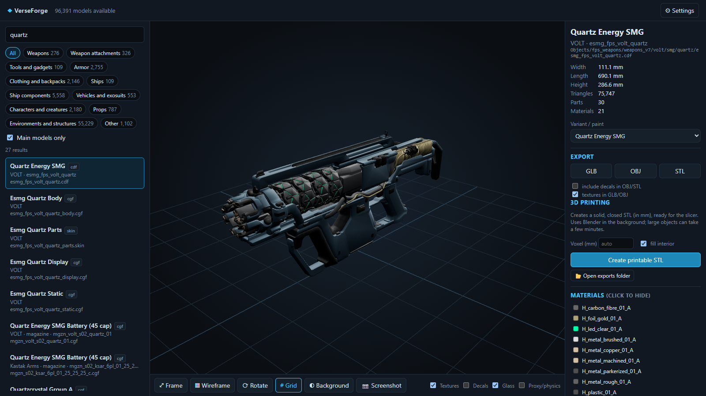

# VerseForge

Programma locale per **cercare, vedere in 3D ed esportare** i modelli di Star Citizen (armi, accessori, strumenti,
armature, abiti, navi, componenti, veicoli, oggetti…) direttamente dal `Data.p4k` del gioco installato.
Non modifica i file del gioco e non scarica nulla: legge l'archivio in sola lettura.

> **English:** VerseForge is a local Windows tool to search, view in 3D and export (GLB / OBJ / STL, plus a closed
> STL ready for 3D printing) the models of Star Citizen, read directly from your own installed `Data.p4k`.
> The interface is available in English and Italian. Download the installer from the [Releases](../../releases) page.



> Progetto non ufficiale di un fan, non affiliato né approvato da Cloud Imperium Games. Il repository **non contiene
> file, modelli o texture del gioco**: serve una copia di Star Citizen installata.

I video dimostrativi (`01_cerca_e_visualizza.mp4`: ricerca, visualizzatore, navi, materiali; `02_esporta_e_stampa.mp4`:
esportazione GLB/OBJ/STL, STL per la stampa 3D, impostazioni) sono allegati alla [Release](../../releases).
Si rigenerano in `docs/video/` con `python tools/registra_video.py` mentre l'app è in esecuzione: lo script pilota
Edge/Chrome in modalità headless e comprime in H.264 con il transcoder di Windows (`tools/comprimi_video.ps1`).

## Avvio

### Programma Windows (consigliato)

Scarica **`VerseForge-<versione>-Setup.exe`** dalla pagina [Releases](../../releases) e installalo: non servono permessi
di amministratore né Python. Crea la voce nel menu Start (e, se vuoi, l'icona sul desktop); si disinstalla da
*Impostazioni → App*.

VerseForge si apre nella sua finestra, senza browser e senza console, e funziona anche senza internet.

### Versione browser (da sorgente)

Doppio clic su **`Avvia VerseForge (browser).bat`**: serve Python 3.11+ (le dipendenze in `requirements.txt` si
installano da sole), si apre il browser su <http://127.0.0.1:8765> e per chiudere basta chiudere la finestra nera.
`python verseforge_app.py` avvia invece la versione a finestra da sorgente (richiede anche PySide6:
`python -m pip install -r requirements-build.txt`).

### Dove salva i dati

| Cosa | Dove |
|---|---|
| Impostazioni | `%APPDATA%\VerseForge\config.json` |
| Cache (indice di Data.p4k, nomi) | `%LOCALAPPDATA%\VerseForge` (rigenerata da sola dopo ogni patch) |
| Esportazioni | `Documenti\VerseForge` (cambiabile nelle impostazioni) |
| Log della versione .exe | `%LOCALAPPDATA%\VerseForge\verseforge.log` |

Il gioco di default è cercato in `C:\Program Files\Roberts Space Industries\StarCitizen\LIVE\Data.p4k`;
se è altrove (o per usare PTU) cambialo da **⚙ Impostazioni**. Per l'esportazione "stampa 3D" serve Blender
(rilevato in automatico, oppure indicalo nelle impostazioni).

### Ricostruire l'.exe

`build_exe.bat` rigenera `dist\VerseForge\` (PyInstaller, `VerseForge.spec`) e l'installer (Inno Setup,
`installer\VerseForge.iss`). Le dipendenze per la build sono in `requirements-build.txt`.
La versione si cambia in `sc_explorer/__init__.py`, `version_info.txt` e nello script .iss.

## Uso

- **Ricerca**: scrivi nella casella in alto a sinistra. Funzionano i nomi del gioco ("P4-AR", "Morozov-SH",
  "Arrowhead"), i nomi delle navi ("Gladius", "Cutlass") e i nomi dei file ("brfl_fps_behr"). Trattini e spazi
  sono ignorati, più parole vanno tutte trovate.
- **Categorie**: i bottoni filtrano per tipo. "Solo modelli principali" nasconde LOD, decal, proxy di fisica,
  pezzi interni delle navi: toglilo per vedere ogni singolo file.
- **Visualizzatore**: trascina per ruotare, rotella per lo zoom, tasto destro per spostare.
  Tasti: `F` inquadra, `W` wireframe, `R` rotazione automatica, `G` griglia.
  Puoi nascondere decal, vetri, proxy e i singoli materiali dal pannello di destra.
- **Variante / verniciatura**: per armi, armature, navi e oggetti che nel gioco hanno più skin o livree compare un
  menu nel pannello di destra (es. Quartz "Jungle Camo", livree del Gladius). Colori e materiali vengono dal database
  del gioco (`Game2.dcb`); la prima voce è la verniciatura di serie. Anche l'esportazione usa la variante scelta.
- **Altri file nella cartella**: elenco dei pezzi collegati (es. calcio, caricatori, ruote, interni).
- **Lingua**: interfaccia in inglese o italiano, da **⚙ Impostazioni → Lingua**. Al primo avvio segue la lingua di
  Windows. I nomi degli oggetti restano quelli del gioco (inglese).

## Esportazione

| Formato | Contenuto |
|---|---|
| **GLB** | glTF binario con materiali e texture (colore + normal map, fino a 2048 px), metri, Y in alto. Si apre in Blender, Visualizzatore 3D di Windows, ecc. |
| **OBJ** | zip con `.obj` + `.mtl` + cartella `textures/` (JPG/PNG), metri, Y in alto |
| **STL** | superfici grezze del gioco in **millimetri**, Z in alto. Non è chiuso: va bene per riferimento, non per stampare |
| **STL per stampa** | solido chiuso e riempito, in mm, pronto per lo slicer (Blender in background: solidify + voxel remesh, poi riempimento dell'interno). Su oggetti grandi può richiedere minuti |

Le texture si possono escludere togliendo la spunta "texture in GLB/OBJ" (file molto più piccoli).
Ogni esportazione viene anche salvata in `Documenti\VerseForge` (cambiabile nelle impostazioni).
Per una stampa grande la divisione in pezzi con perni va fatta a parte (es. in Blender o nello slicer).

## Limiti noti

- **Texture approssimate**: vengono caricate la texture di colore (`_diff`) e la normal map (`_ddna`) di ogni
  materiale; per i materiali a strati (`LayerBlend`, `HardSurface` di navi e armi) si usa il primo strato ripetuto
  secondo il suo `UVTiling`, con i colori della tavolozza della variante scelta. Non sono ricostruiti usura, sporco,
  maschere di miscela tra strati, luci emissive e decal colorate dalla tavolozza: il risultato è vicino al gioco ma non
  identico. Interruttore **Texture** in basso nel visualizzatore per confrontare.
- **Navi**: viene assemblato lo scafo con tutti i suoi nodi (ali, carrelli, portelli…). Armi, motori e componenti
  montati sugli hardpoint e gli interni (file `.socpak`) sono oggetti separati, cercabili a parte.
- **Nomi del gioco**: ricavati dall'ordine delle stringhe nel DataCore (non un'analisi completa). Sono corretti per
  quasi tutte armi, armature, abiti e veicoli; per oggetti decorativi possono essere imprecisi, per questo nelle
  categorie Ambienti/Altro restano i nomi dei file.
- Alcuni `.cdf`/`.cga` sono solo contenitori senza geometria: il programma lo segnala.
- I modelli sono di proprietà di Cloud Imperium Games / Roberts Space Industries: usali solo per scopi personali e
  non commerciali.

## Struttura

```
avvia.py                 versione browser: server (uvicorn) e apertura del browser
sc_explorer/p4k.py       lettura di Data.p4k (ZIP64, zstd, AES)
sc_explorer/ivo.py       formato geometria #ivo (.cgf/.cga/.skin/.chr + file *m)
sc_explorer/cryxml.py    XML binario CryEngine (.mtl, .cdf)
sc_explorer/materials.py materiali: nomi, colori, texture, tipo (solido/decal/vetro/proxy)
sc_explorer/datacore.py  lettura del database del gioco (Game2.dcb, formato v8)
sc_explorer/variants.py  verniciature: per ogni modello le skin/livree con materiale e tavolozza di colori
sc_explorer/textures.py  texture .dds divise in mip (.dds.1 … .dds.N), decodifica BC1–BC7 (BC5 firmato a mano)
sc_explorer/model.py     assemblaggio: nodi delle navi, attacchi dei .cdf sulle ossa
sc_explorer/catalog.py   catalogo, categorie, nomi del gioco, ricerca
sc_explorer/i18n.py      lingua dell'interfaccia: testi del server (inglese/italiano); quelli della pagina sono in web/app.js
sc_explorer/export.py    GLB / OBJ / STL
sc_explorer/printing.py  STL chiuso per la stampa 3D (Blender + riempimento)
sc_explorer/server.py    API web
web/                     interfaccia (HTML/CSS/JS); three.js 0.160 incluso in web/vendor (licenza MIT)
verseforge_app.py        programma a finestra (Qt WebEngine), punto di ingresso di VerseForge.exe
VerseForge.spec          configurazione PyInstaller; installer/VerseForge.iss per Inno Setup
tests/test_formats.py    test sul gioco installato (python -m pytest tests; saltati se Data.p4k manca)
tools/                   registrazione e compressione dei video dimostrativi
```

Dettagli dei formati scoperti durante lo sviluppo:

- Stream dei vertici `0xB3A70D5E`: posizione snorm16 scalata con `max(|max-min|/2, 1)` per asse e traslata al
  centro del bounding box; `0x91329AE9`: posizione float32. L'header della mesh ha due bounding box: il primo
  (offset +24) è in spazio oggetto, il secondo (+48) è l'unione dei box locali dei nodi. Se il file ha la tabella dei
  nodi le posizioni vanno decodificate col secondo e poi trasformate dal nodo (`ivo.mesh(..., node_space=True)`):
  col primo le navi grandi a più nodi (es. Perseus) uscivano spostate e deformate. I LOD senza nodi usano il primo.
- Subset della mesh (48 byte): `materiale | nodo<<16`, primo indice, n. indici, primo vertice, **base degli indici**
  (da sommare agli indici a 16 bit), n. vertici.
- Chunk nodi `0x70697FDA`: record da 208 byte; la prima matrice 3×4 è la trasformazione nello spazio dell'oggetto.
  Seguono indici, id materiali e la tabella dei nomi dei nodi.
- Ossa `0xC2011111`: record da 68 byte (id, parent, quaternione e posizione relativi e mondo), nomi in coda.

## Licenza

Il codice di VerseForge è distribuito con licenza [MIT](LICENSE). La licenza riguarda solo il codice: Star Citizen,
i suoi file e i modelli/texture letti da `Data.p4k` restano di Cloud Imperium Games / Roberts Space Industries e vanno
usati solo per scopi personali e non commerciali. three.js (`web/vendor/three`) è incluso con licenza MIT.
