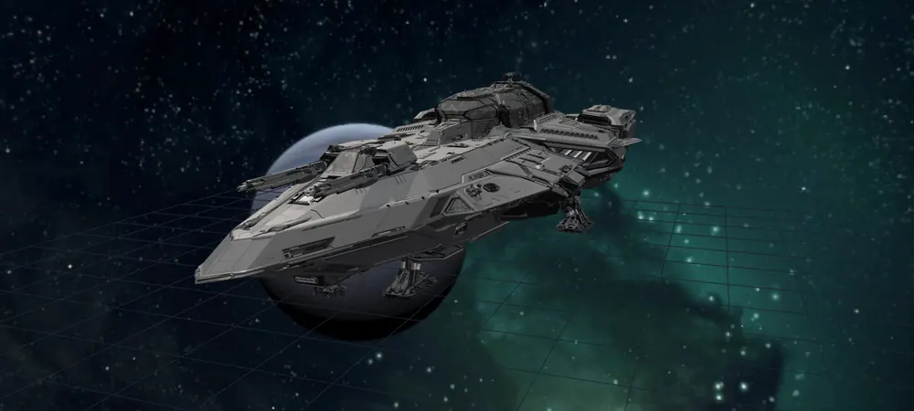
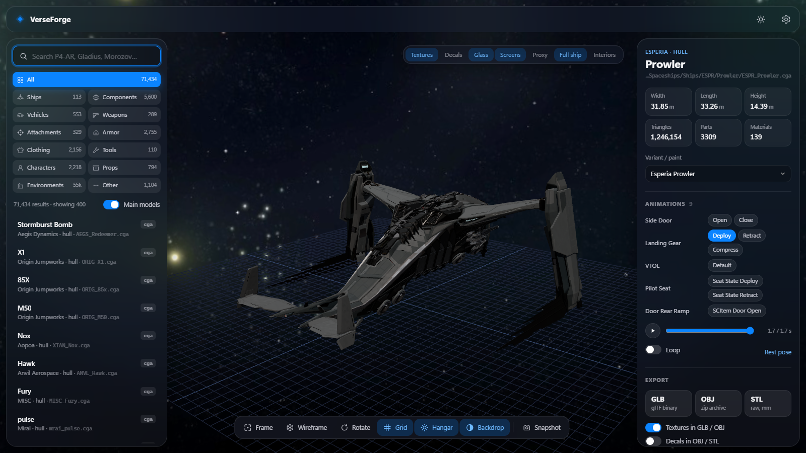
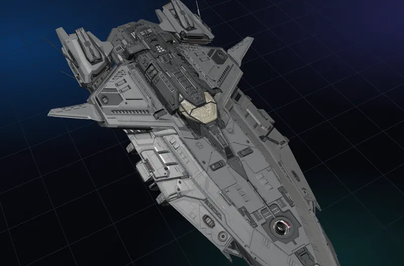
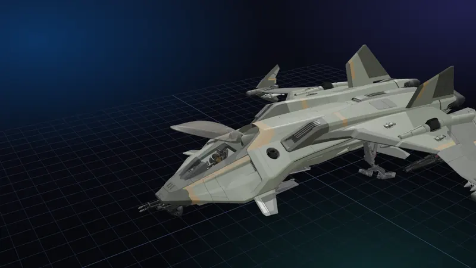
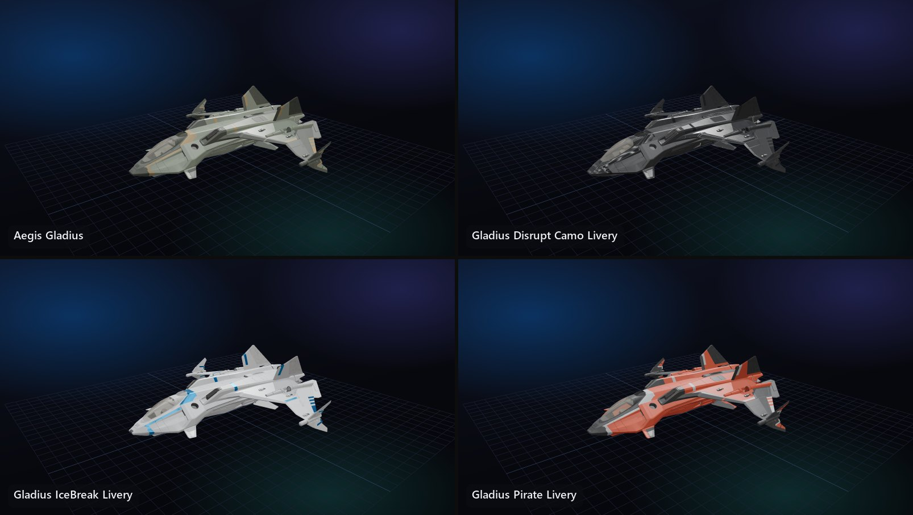
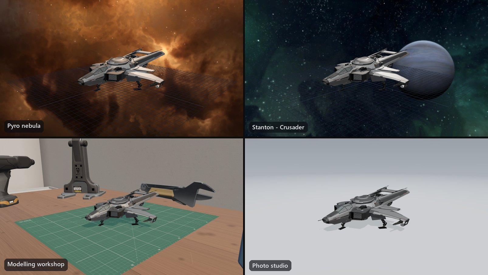

<div align="center">


# VerseForge

**Explore every ship, weapon and armour set of Star Citizen in 3D, straight from your own game files,<br>
and export them for Blender, your renders or your 3D printer.**

[](../../releases/latest)
[](../../releases/latest)
[](LICENSE)

### [⬇&nbsp; Download for Windows](../../releases/latest)

<br>



</div>

<br>

> [!NOTE]
> Unofficial fan project, not affiliated with or endorsed by Cloud Imperium Games. The repository **contains no game
> files, models or textures**: VerseForge reads them from your own installed copy of Star Citizen.

## What you can do

<table>
<tr>
<td width="55%"></td>
<td>

### Find anything in the game
Over **70,000 models**: 113 ships, 550 vehicles, weapons, attachments, armour, clothing, tools, characters and props.
Search by in-game name (*P4-AR*, *Morozov-SH*, *Gladius*) or file name, then browse by category and manufacturer.

</td>
</tr>
<tr>
<td>

### Look inside the ships
Turn on **Interiors** and rooms, corridors and props are placed in the hull as the game does. The section slider
cuts the ship open, and you can also view one deck at a time.

</td>
<td width="55%"></td>
</tr>
<tr>
<td width="55%"></td>
<td>

### Full ships that move
**Full ship** mounts the factory loadout: landing gear, guns, missiles, thrusters and seats. The game's own
animations play and scrub on a timeline: canopies, ramps, doors, landing gear, weapons firing and reloading.

</td>
</tr>
<tr>
<td>

### Every paint and livery
Skins and liveries come from the game database, colour palette included, with camo patterns and decals drawn like
in game. Exports use the paint you picked.

</td>
<td width="55%"></td>
</tr>
<tr>
<td width="55%"></td>
<td>

### Backdrops for screenshots
Choose from several backdrops, with hangar lighting and shadows or a plain studio light.

</td>
</tr>
</table>

### Take it out of the game

| Format | What you get |
|---|---|
| **GLB** | Binary glTF with materials, textures and animations: opens in Blender, Windows 3D Viewer, game engines |
| **OBJ** | Zip with `.obj`, `.mtl` and textures |
| **STL** | Raw surfaces in millimetres, as a reference |
| **STL for printing** | A closed, solid mesh ready for the slicer (made with Blender in the background) |

## Getting started

1. **Download** `VerseForge-<version>-Setup.exe` from the [latest release](../../releases/latest) and install it.
   No administrator rights and no Python needed.
2. **Open VerseForge.** It finds the game in `C:\Program Files\Roberts Space Industries\StarCitizen\LIVE`; if yours
   is elsewhere (or you want the PTU), set the path in **Settings** (gear icon, top right).
3. **Search and explore.** Drag to orbit, scroll to zoom, right-drag to pan. VerseForge checks for new versions at
   startup and updates itself when you agree.

Windows SmartScreen may warn about an unrecognised app because the installer is not code-signed, just choose
*More info → Run anyway*.

## Documentation

<details>
<summary><b>Using VerseForge</b>: search, viewer, backdrops, paints, animations, full ship, interiors</summary>

- **Search**: type in the box at the top left. In-game names ("P4-AR", "Morozov-SH", "Arrowhead"), ship names
  ("Gladius", "Cutlass") and file names ("brfl_fps_behr") all work. Dashes and spaces are ignored; with several
  words, all of them must match.
- **Categories**: the tiles under the search box filter by type, grouped as ships and vehicles, personal gear and the
  rest (the full name and exact count are in each tile's tooltip). Picking a category shows a second row with its
  sub-categories (pistols, shotguns, LMGs… for weapons; helmets, light/medium/heavy armor… for armor; manufacturers
  for ships). The "Main models" switch hides LODs, decals, physics proxies and ship interior parts: turn it off to see
  every single file.
- **Viewer**: drag to rotate, wheel to zoom, right button to pan.
  Keys: `F` frame, `W` wireframe, `R` auto-rotate, `G` grid (also in the toolbar at the bottom).
  Textures, decals, glass, screens and proxies are toggled at the top right of the viewer; single materials can be
  hidden from the right panel. *Screens* (shown on models that have them) switches the cockpit and weapon screens and
  the holographic HUDs; *Proxy* shows what the game never draws (collision shapes, shields, placeholders).
- **Backdrop** (toolbar): plain (default or inverted); *Pyro nebula* and *Stanton · Crusader*, 360° space panoramas
  made from the game's own sky textures (the Pyro skybox, Stanton's nebula layers and the gas giant Crusader); a
  *Modelling workshop*: a lived-in room with a table, a cutting mat with a centimetre grid and props taken from the
  game (desk lamp, toolboxes, drill, tool chest); behind the table a wall of shelves holds paints, spray cans, tools,
  action figures and ship miniatures, and a window in the side wall looks onto Stanton's sky. The model stands on the
  mat as a scale model (1:72, 1:144… so a ship is 20-40 cm long; weapons and armour at real size, the scale is printed
  on the mat); a seamless *Photo studio* floor. Each backdrop sets its own light and shadows, and snapshots include it.
- **Variant / paint**: for weapons, armor, ships and items that have several skins or liveries in the game, a menu
  appears in the right panel (e.g. Quartz "Jungle Camo", Gladius liveries). Colours and materials come from the
  game database (`Game2.dcb`); the first entry is the default paint. Exports use the selected variant too.
- **Same folder**: list of the related parts (e.g. stock, magazines, wheels, interiors).
- **Animations**: when the game links animations to the object (weapons firing and reloading, multi-tools, ship
  canopies, ladders, landing-gear doors, component panels…), an *Animations* panel lists them by group (Canopy:
  Open · Close · Eject). Several can stay applied at once; *Loop* repeats the current one, the slider scrubs it and
  *Rest pose* puts everything back. They are found automatically from the object's `.chrparams` (clips in `.caf`
  files or `.dba` databases) and named after the game's Mannequin database (`.adb`) when it has one. The GLB export
  includes them (switch *Animations in GLB*): in Blender each clip becomes an action.
- **Full ship / Full vehicle**: for ships and ground vehicles a switch at the top right of the viewer mounts the
  factory loadout read from the game database: landing-gear legs, weapons on their mounts, missiles, thrusters,
  seats, dashboard and components, each on its item port. A full ship starts landed (gear down); the hull's landing
  gear actions also move the legs, and component animations (gun recoil, missile clamps…) are listed under their
  port. Exports and the 3D print use the full ship while the switch is on (files get a `_full` suffix).
- **Interiors**: for ships with object containers an *Interiors* switch mounts rooms, corridors and props inside the
  hull (placed as the game does, from the vehicle record and the `.socpak` containers). The *Section* slider cuts the
  model horizontally to look inside (it starts at 100%, the whole ship); next to it, the ship's decks are found
  automatically (the levels where the interior's floors are) and each deck button takes away everything above that
  deck. Exports include the interior while the switch is on (`_interior` suffix).
- **Game look**: materials follow the game's spec/gloss model (coloured reflectance, gloss maps, ambient occlusion,
  detail normals), paints with camo patterns are drawn with their stencil masks, and parallax decals shade the paint
  under them instead of printing over it. The *Hangar* button in the toolbar switches to a dark hangar light with
  shadows, close to how ships look in game; the studio light stays available.
- **Cache** (Settings → Cache): models and textures already opened are kept on disk, so they open again much faster
  (a ship with its interior: about 5-8 s the first time, under a second afterwards). Up to 10 GB, least recently
  used files are removed first; a new game patch or program version starts a fresh cache. The switch turns it off,
  *Clear* empties it.
- **Light / dark mode**: the sun/moon button in the top bar switches it; by default it follows Windows
  (also selectable in **Settings → Appearance**).
- **Updates**: at startup VerseForge checks the [Releases](../../releases) page. When a newer version exists it shows
  what is new and asks whether to update: **Update now** downloads the installer (checking its SHA-256), installs it
  and reopens the program; **Later** keeps an "Update" button in the top bar; **Skip this version** stops asking until
  the next one. The check can be turned off, or run by hand, in **Settings → Updates**. Nothing else is sent anywhere.
- Item names are the in-game (English) names.

</details>

<details>
<summary><b>Export formats</b> in detail</summary>

| Format | Content |
|---|---|
| **GLB** | Binary glTF with materials and textures (colour + normal map, up to 2048 px), metres, Y up. Opens in Blender, Windows 3D Viewer, etc. |
| **OBJ** | Zip with `.obj` + `.mtl` + a `textures/` folder (JPG/PNG), metres, Y up |
| **STL** | Raw game surfaces in **millimetres**, Z up. Not closed: fine as a reference, not for printing |
| **STL for printing** | Closed, filled solid in mm, ready for the slicer (Blender in the background: solidify + voxel remesh, then the interior is filled). Large objects can take minutes |

Textures can be left out by turning off "Textures in GLB / OBJ" (much smaller files).
Every export is also saved in `Documents\VerseForge` (can be changed in the settings).
For a large print, splitting into pegged pieces has to be done separately (e.g. in Blender or in the slicer).
The "STL for printing" export needs Blender (detected automatically, or set its path in the settings).

</details>

<details>
<summary><b>Where data is stored</b></summary>

| What | Where |
|---|---|
| Settings | `%APPDATA%\VerseForge\config.json` |
| Cache (Data.p4k index, names, opened models) | `%LOCALAPPDATA%\VerseForge` (rebuilt automatically after every patch) |
| Exports | `Documents\VerseForge` (can be changed in the settings) |
| Log of the .exe version | `%LOCALAPPDATA%\VerseForge\verseforge.log` |

VerseForge never modifies the game files and downloads nothing from them: `Data.p4k` is opened read-only.

</details>

<details>
<summary><b>Known limitations</b></summary>

- **Approximate textures**: colour, normal, gloss, specular and ambient-occlusion maps are loaded; for layered
  materials (`LayerBlend`, `HardSurface` on ships and weapons) the first layer is used, repeated according to its
  `UVTiling`, with the palette colours of the selected variant. Wear, dirt, the 4-layer blend masks, emissive maps
  and post effects (ambient occlusion, bloom) are not reconstructed: the result is close to the game but not
  identical. Use the **Textures** toggle at the top right of the viewer to compare.
- **Ships**: the hull is assembled with all its nodes (wings, landing gear, doors…). Weapons, engines and components
  mounted on hardpoints appear with *Full ship*, interiors with *Interiors*. Interior props use their LOD1 meshes and
  neutral grey palettes (the ships' own interior palettes are not read yet); very large ships (Polaris, Idris) are
  heavy with the interior on.
- **Animations**: moving parts are rigid (skinned meshes follow their main bone, fine for mechanical parts);
  additive clips (offsets such as `*_add`) are left out. Without *Full ship* only the hull moves; the legs and other
  hardpoint items are separate objects with their own animations. Loadout items whose port is not in the model are
  skipped (the viewer tells how many); modular parts without a port node (gun barrels) hang from their parent.
- **In-game names**: derived from the order of the strings in DataCore (not a full parse). They are correct for
  almost all weapons, armor, clothing and vehicles; for decorative props they can be inaccurate, which is why the
  Environments/Other categories keep the file names.
- Some `.cdf`/`.cga` files are only containers without geometry: the program reports it.
- The models are the property of Cloud Imperium Games / Roberts Space Industries: use them only for personal,
  non-commercial purposes.

</details>

<details>
<summary><b>Running from source and building</b></summary>

**Browser version**: double-click **`Start VerseForge (browser).bat`**. It needs Python 3.11+ (the dependencies in
`requirements.txt` are installed automatically), the browser opens on <http://127.0.0.1:8765>, and closing the black
console window stops it. `python verseforge_app.py` runs the windowed version from source instead (it also needs
PySide6: `python -m pip install -r requirements-build.txt`, which installs PySide6 and PyInstaller).

**Rebuilding the .exe**: `build_exe.bat` rebuilds `dist\VerseForge\` (PyInstaller, `VerseForge.spec`) and the
installer (Inno Setup, `installer\VerseForge.iss`). The version number lives in `sc_explorer/__init__.py`,
`version_info.txt` and the .iss script.

**Tools** (`tools/`):
- `record_video.py` records the demo videos in `docs/video/` while the app is running (headless Edge/Chrome, H.264
  through the Windows transcoder, `compress_video.ps1`).
- `readme_media.py` makes the images and animations of this page in `docs/readme/`.
- `flash_check.py` films the desktop app while it drives a repeatable random sample of actions and counts the frames
  where a panel is missing (the "flashing panels" check).

</details>

<details>
<summary><b>Project structure and file formats</b></summary>

```
start.py                 browser version: server (uvicorn) and opening the browser
sc_explorer/p4k.py       Data.p4k reader (ZIP64, zstd, AES)
sc_explorer/ivo.py       #ivo geometry format (.cgf/.cga/.skin/.chr + *m files)
sc_explorer/cryxml.py    CryEngine binary XML (.mtl, .cdf)
sc_explorer/materials.py materials: names, colours, textures, kind (solid/decal/glass/proxy)
sc_explorer/datacore.py  game database reader (Game2.dcb, format v8)
sc_explorer/variants.py  paints: for every model, the skins/liveries with their material and colour palette
sc_explorer/textures.py  .dds textures split into mips (.dds.1 … .dds.N), BC1–BC7 decoding (signed BC5 by hand)
sc_explorer/model.py     assembly: ship nodes, .cdf attachments on bones
sc_explorer/assembly.py  full ship (loadout on item ports) and interiors
sc_explorer/containers.py object containers (.socpak): placed brushes and entities of ship interiors
sc_explorer/backdrops.py 360° space panoramas (Pyro, Stanton) from the game's sky textures
sc_explorer/diskcache.py disk cache of built models (GLB, info) and textures, per program and game version
sc_explorer/catalog.py   catalogue, categories, in-game names, search
sc_explorer/i18n.py      texts produced by the server (status, categories, warnings)
sc_explorer/export.py    GLB / OBJ / STL
sc_explorer/printing.py  closed STL for 3D printing (Blender + interior fill)
sc_explorer/server.py    web API
sc_explorer/updates.py   new versions: GitHub releases check, installer download and hand-over
web/                     interface (HTML/CSS/JS); three.js 0.160 bundled in web/vendor (MIT license)
web/gamelook.js          game-look materials (spec/gloss, camo stencils, POM decals); web/hangar.js hangar light
web/backdrops.js         viewer backdrops: space panoramas, modelling workbench, photo studio
verseforge_app.py        windowed app (Qt WebEngine), entry point of VerseForge.exe
VerseForge.spec          PyInstaller configuration; installer/VerseForge.iss for Inno Setup
tests/test_formats.py    tests against the installed game (python -m pytest tests; skipped if Data.p4k is missing)
tests/test_updates.py    version comparison and release parsing of the updater (no network needed)
tools/                   demo videos, README images, flashing-panels check
```

Format details discovered during development:

- Vertex stream `0xB3A70D5E`: snorm16 position scaled by `max(|max-min|/2, 1)` per axis and offset to the centre of
  the bounding box; `0x91329AE9`: float32 position. The mesh header has two bounding boxes: the first (offset +24)
  is in object space, the second (+48) is the union of the nodes' local boxes. If the file has a node table, the
  positions must be decoded with the second one and then transformed by the node (`ivo.mesh(..., node_space=True)`):
  with the first one, large multi-node ships (e.g. Perseus) came out shifted and distorted. LODs without nodes use the
  first one.
- Mesh subset (48 bytes): `material | node<<16`, first index, index count, first vertex, **index base**
  (to be added to the 16-bit indices), vertex count.
- Node chunk `0x70697FDA`: 208-byte records; the first 3×4 matrix is the transform into object space.
  Indices, material ids and the node name table follow.
- Bones `0xC2011111`: 68-byte records (id, parent, relative and world quaternion and position), names at the end.

</details>

## License

VerseForge's code is released under the [MIT](LICENSE) license. The license covers only the code: Star Citizen, its
files and the models/textures read from `Data.p4k` remain the property of Cloud Imperium Games / Roberts Space
Industries and should be used only for personal, non-commercial purposes. three.js (`web/vendor/three`) is bundled
under the MIT license.
