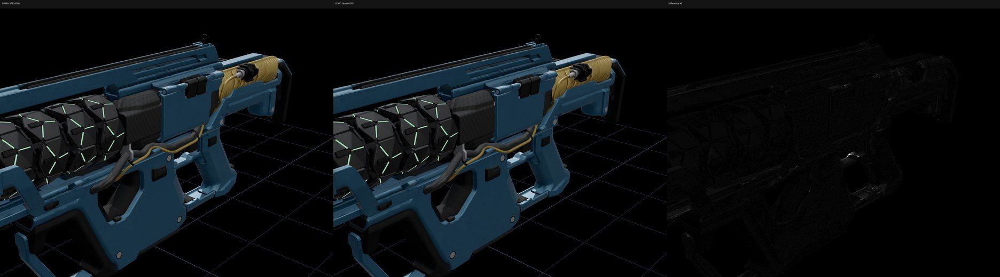
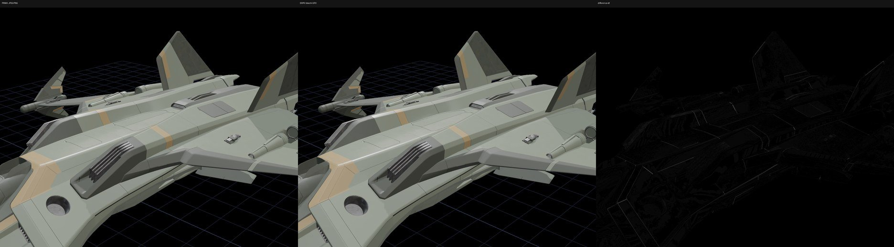
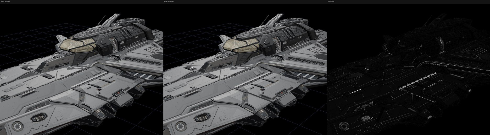

# Ottimizzazione 8: texture del gioco mandate alla scheda video ancora compresse

**Esito: da tenere.** Il visore carica le texture 3–4 volte più in fretta e usa circa 5 volte meno memoria
video. A occhio non cambia nulla.

## Cosa cambia

**Prima.** Il server apriva i file DDS del gioco, che sono compressi in blocchi (BC1, BC3, BC4, BC5, BC7).
Li decomprimeva e li ricomprimeva in JPEG o PNG. Il browser poi li decomprimeva di nuovo e li caricava sulla
scheda video senza compressione (4 byte per pixel, più le mipmap che calcolava da solo).

**Dopo.** Il server copia i blocchi del gioco così come sono, dalla mip giusta (al massimo 1024 px) fino alla
più piccola, e li manda in un file DDS. Il visore li carica come `THREE.CompressedTexture`: la scheda video li
legge direttamente, senza decodifica e senza ricalcolare le mipmap. Sul filo i dati viaggiano con zstd, che
il browser e il Qt WebEngine scompattano da soli: così pesano metà.

Quali mappe passano dai blocchi:

| Tipo di mappa | Formati mandati compressi | Note |
|---|---|---|
| colore, spec, HAL | BC1, BC2, BC3, BC7 | sRGB per il colore, come prima |
| normali | BC5 con o senza segno, BC1/3/7 | per il BC5 la Z viene ricostruita nello shader (`GAME_N_RG` / `GAME_N_SRG`) |
| gloss (file `.dds.a`) | BC4, BC1/3/7 | lo shader legge solo il rosso, come prima |
| maschere | BC1/3/7 | le maschere camo (RGB non compresso) e le stencil R8G8 restano PNG |

Tutto il resto torna da solo al percorso di prima (JPEG/PNG) senza nessun passaggio in più. Succede con il gloss
nell'alfa della mappa principale, i formati non compressi, le misure non multiple di 4, un BC4/BC5 usato come
colore, e le schede video senza l'estensione giusta. Con `?gputex=0` nell'indirizzo si torna al percorso vecchio
(l'ho usato per i confronti).

## Misure

Server riavviato a freddo prima di ogni giro (`--no-disk-cache`), 6 richieste in parallelo come il browser
(`tools/bench_server.py --textures [--gpu s3tc,rgtc,bptc]`). Ho fatto due giri per ogni percorso, alternati. Il
computer era carico per via delle altre sessioni in parallelo: contano i rapporti, non i decimi.

| | Perseus con interni: prima | Perseus con interni: dopo | Carrack con interni: prima | Carrack con interni: dopo |
|---|---|---|---|---|
| Texture richieste | 213 | 213 | 440 (4 mancanti) | 440 (4 mancanti) |
| **Tempo totale texture** (server) | 2,9 s / 2,8 s | **0,7 s / 0,8 s** | 4,8 s / 5,4 s | **1,3 s / 1,4 s** |
| Tempo per texture: media | 81 / 78 ms | **20 / 21 ms** | 65 / 72 ms | **16 / 18 ms** |
| Tempo per texture: mediana | 68 / 64 ms | 17 / 16 ms | 55 / 57 ms | 14 / 15 ms |
| **Byte trasmessi** | 143 MB | **98 MB** (207 MB scompattati) | 179 MB | **137 MB** (304 MB scompattati) |
| **VRAM stimata delle texture** | 1107 MiB | **226 MiB** | 1547 MiB | **295 MiB** |
| Costruzione del modello (invariata) | 12,4 / 10,7 s | 13,8 / 12,0 s | 16,7 / 14,1 s | 14,8 / 14,4 s |

Come ho stimato la VRAM: prima, ogni JPEG/PNG diventa RGBA8 (4 byte per pixel, anche i gloss in grigio) più la
catena di mip (× 4/3). Dopo, conto i byte dei blocchi con tutte le mip mandate (BC1/BC4 = 0,5 byte per pixel,
BC3/BC5/BC7 = 1 byte per pixel).

Formati arrivati per il Perseus: 92 mappe colore (55 BC1, 24 BC3, 13 BC7), 58 normali BC5 con segno, 57 gloss
BC4. Restano PNG 6 maschere. Il Carrack è simile, con in più 11 HAL BC1, e resta PNG 1 maschera.

**Nel browser** (pannello dell'app Claude, Chromium 156, Radeon RX 7900 XTX), Perseus con interni, server a freddo:

| | Prima | Dopo |
|---|---|---|
| Fase texture (dalla prima all'ultima risposta) | 3,98 s | **1,19 s** |
| Dati texture ricevuti | 181 MB | **118 MB** |
| Primo fotogramma (caricamento sulla scheda video + shader) | 2094 ms | **704 ms** |
| Fotogramma a regime (1600×1200) | 4,2 ms | 3,8 ms (uguale, rumore) |
| Memoria JavaScript (heap) | 665 MB | 957 MB ⚠ |

La memoria JavaScript sale perché three.js tiene in RAM i blocchi compressi (circa 300 MB per il Perseus) per
poterli ricaricare sulla scheda video. Prima la stessa cosa succedeva con le immagini decodificate, che però
stanno fuori dall'heap JavaScript e sono 4–8 volte più grandi. Quindi con buona probabilità la memoria totale del
processo scende, ma non sono riuscito a misurarla dal pannello.

**Supporto dei formati** (WebGL2):

| | s3tc + s3tc_srgb (BC1–3) | rgtc (BC4/BC5) | bptc (BC7) | zstd sul filo |
|---|---|---|---|---|
| Browser dell'app (Chromium 156) | sì | sì | sì | sì |
| Qt WebEngine 6.10.2 dell'exe (Chromium 134) | sì | sì | sì | sì |

Nel Qt WebEngine ho caricato il Gladius dal visore vero: 22 texture compresse, nessuna immagine, nessun errore
WebGL, e il modello si vede giusto. In Direct3D 11 (ANGLE su Windows) questi formati ci sono su qualsiasi scheda
video. Dove mancano, il visore non li chiede e il server risponde come prima.

## Confronto visivo

Stessa inquadratura, prima / dopo / differenza moltiplicata per 8. Scarto medio per pixel su tutto il quadro:
Quartz 0,02–0,13, Gladius 0,01–0,09, Perseus 0,03–0,35 su 255. I pixel che cambiano di più di 16 livelli sono
lo 0,28 % nel caso peggiore (Perseus da vicino, sui bordi delle luci). Il motivo è che spariscono gli artefatti
del JPEG e le mip sono quelle del gioco invece di quelle calcolate dal browser.

## File toccati

- `sc_explorer/textures.py`: `gpu_blocks()` prende i blocchi e le mip dai file `.dds`, `.dds.N` e `.dds.Na` e
  scrive un DDS con header DX10; `TextureCache.gpu()` li tiene in memoria.
- `sc_explorer/server.py`: `/api/texture` accetta `gpu=s3tc,rgtc,bptc` e risponde con
  `image/vnd-ms.dds` (zstd se il client lo accetta). Anche la cache su disco salva i `.dds`. Gli export non
  cambiano.
- `web/gamelook.js`: capisce quali formati regge la scheda video, legge il DDS in `CompressedTexture` e ricostruisce
  la Z delle normali BC5 negli shader (materiale del gioco e decal POM).
- `web/vendor/three/build/three.module.js`: corretto un errore di una riga in three r160. Per il BC4 senza segno
  controllava `RGBA_BPTC_Format` invece di `RED_RGTC1_Format`, e le texture BC4 non si caricavano. Se in futuro
  si aggiorna three.js, bisogna controllare che la correzione ci sia.
- `tools/bench_server.py`: `--textures` (tempi per texture, formati, VRAM) e `--gpu`.
- `tests/test_gpu_textures.py`: 5 test. Controllano che i blocchi mandati, decodificati, diano la stessa immagine
  del percorso vecchio (BC1, BC7, BC5 con segno, gloss BC4), che le maschere tornino al PNG, e che l'endpoint
  risponda con e senza zstd.

## Cosa resta fuori

- Le texture dentro il GLB "lite" sono ancora JPEG/PNG: sono un'altra strada, quella di `export.to_glb`.
- Le 6–7 maschere per modello (camo RGB e stencil R8G8) restano PNG. Si potrebbero mandare come dati grezzi R8/RG8,
  ma il guadagno è piccolo.
- La memoria JavaScript: si potrebbero liberare i blocchi dopo il caricamento sulla scheda video. Però le copie
  "ripetute" delle texture (`clone()` con `needsUpdate`) li ricaricano. Prima andrebbe cambiato il modo in cui
  `GameLook.texture()` gestisce le ripetizioni.
- L'ho provato solo con la scheda AMD di questo PC. Su schede Intel o NVIDIA i formati sono gli stessi
  (Direct3D 11), ma non l'ho verificato.
- Possibili conflitti al momento dell'unione con l'ottimizzazione 7 (texture progressive): toccano entrambe
  `GameLook.texture()` e `/api/texture`.
